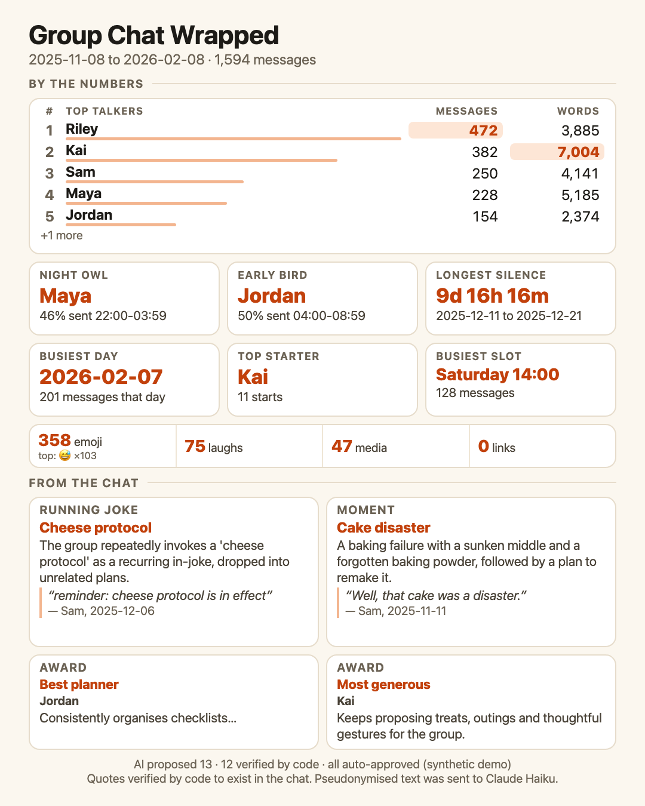
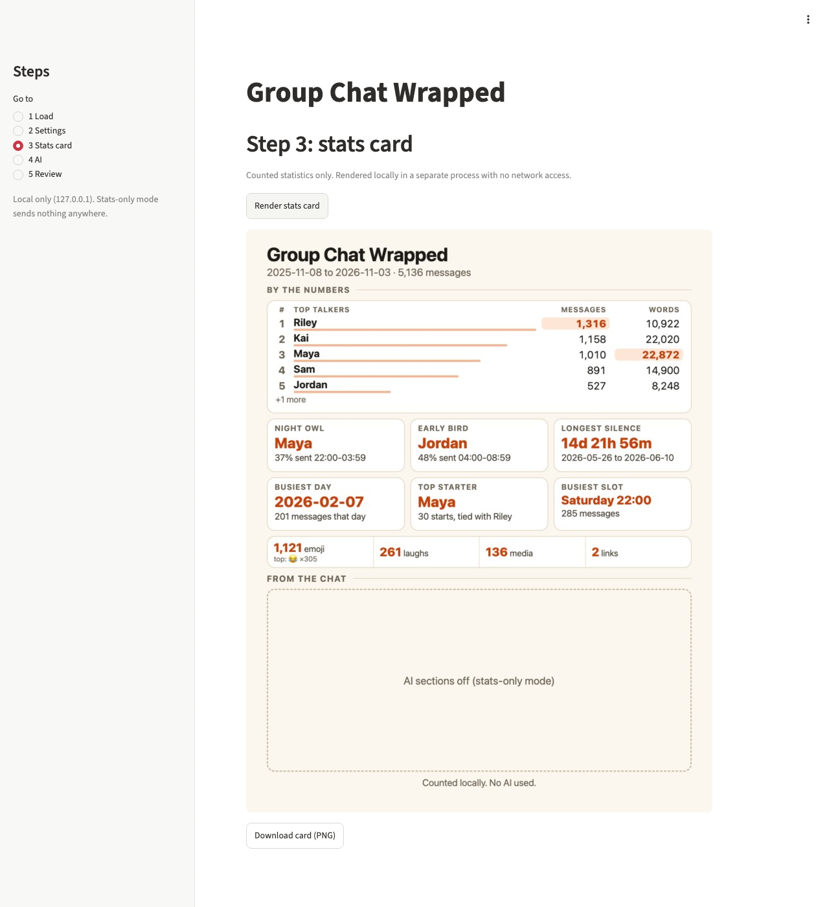
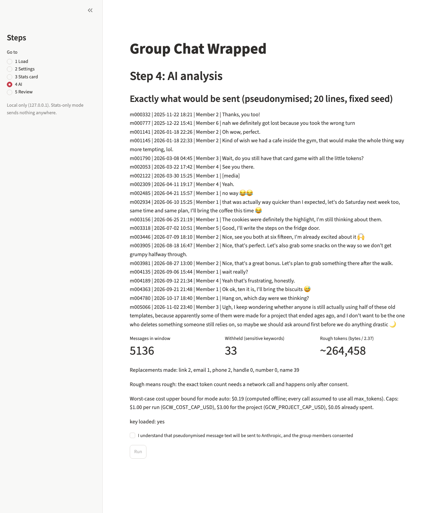
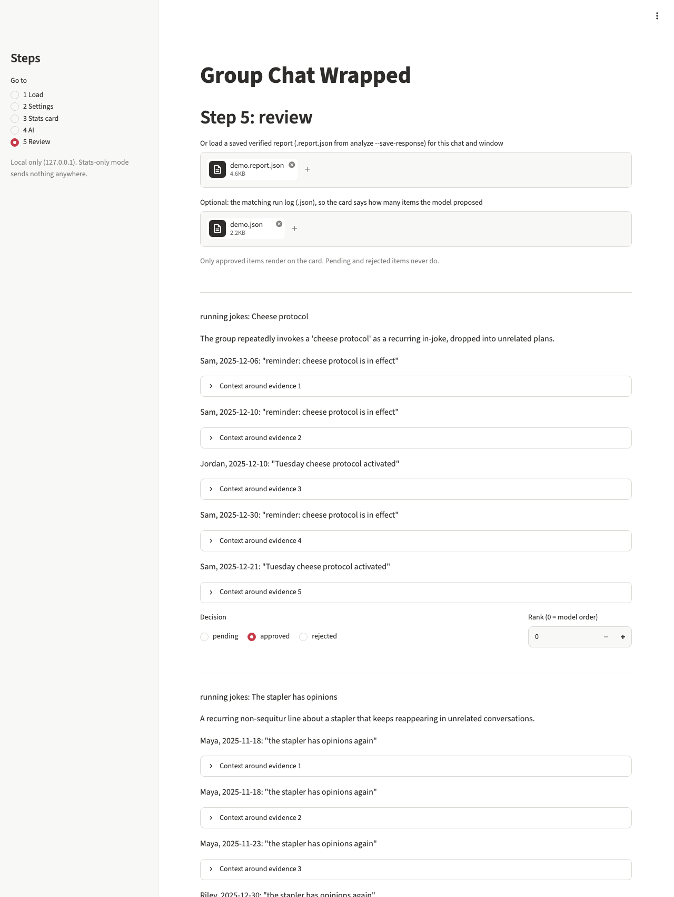

# Group Chat Wrapped

[](https://github.com/devsutharsystems/group-chat-wrapped/actions/workflows/ci.yml)

**Live demo:** https://devsutharsystems.github.io/group-chat-wrapped/ (the cards and the methodology page, built from the files in `site/`).



*A card from the bundled synthetic demo chat (no real chat). The AI items come from a saved model run and are auto-approved for this demo, with no human review; see the screenshots section.*

Group Chat Wrapped turns a WhatsApp group export into a one-page card: counted statistics (top talkers, busiest day, longest silence, response times and so on) and, optionally, items found by a language model (running jokes, moments, awards). It is a Python package (pandas, Playwright for rendering, Claude Haiku for the AI step) with a command-line interface and a local Streamlit app.

## Design choices

1. **Every quote behind an AI claim is checked in code against the real message.** Each kept quote is an exact substring of the cited message (after normalisation, at least 12 characters), and an item is kept only if it meets the item rules: a running joke needs at least 3 verified evidence messages on at least 2 dates, a moment at least 1, and an award at least 1 from the named member. Items that fail are dropped, and the drop counts by reason are reported in the run output and in `docs/results/`. A claim the model cannot back with a real quote does not reach the card. What the code checks is that every kept quote exists in the cited message and meets the item rules; it does not check whether the quotes support the item's title and summary. That is what the hand rating measures (see Precision below).
2. **Privacy by design, with the limits stated.** Names are replaced before anything is sent, a keyword screen withholds sensitive messages, and `preview` shows the exact text that would be sent. Stats-only mode (the default) makes no network call. AI mode needs an explicit consent step and runs under a cost cap. Pseudonymised text is still sent to Anthropic in AI mode; see the privacy section.
3. **A measured evaluation on a synthetic chat with planted ground truth.** The test chats contain jokes, moments and other items planted at known positions, so recall numbers, and precision once the hand ratings exist, are computed rather than asserted. The numbers, their sample sizes and their limits are below; they are not claims about real chats.

## Results in brief

<!-- BEGIN:brief -->
- Hand-rated precision (n = 40, rated by the author, not blind), strict / lenient: overall 21 of 40 (52.5%) / 39 of 40 (97.5%); running jokes 18 of 21 (85.7%) / 21 of 21 (100.0%); moments 1 of 12 (8.3%) / 12 of 12 (100.0%); awards 2 of 7 (28.6%) / 6 of 7 (85.7%).
- Strict recall of planted items on the dense chat (item-runs found, n = 3 runs each): single-pass 25 of 30, chunked 27 of 30.
- Cost per run on the dense chat, computed from usage fields and not reconciled with the Console: single-pass $0.1402, chunked $0.0329.
- Large chat at 889,497 tokens (n = 1 run each; planted density 0.39% against 1.30% on the dense chat, so the comparison is confounded): single-pass found 0 of 10 planted items, chunked 5 of 10.
<!-- END:brief -->

Details, definitions and limits are in the Evaluation and Limits sections below.

## Quickstart

Requires Python 3.11 or newer (`requires-python` in `pyproject.toml`). CI covers Python 3.11 and 3.13; local runs used Python 3.15.0.

```sh
python3 -m venv .venv
PIP_CACHE_DIR=.cache/pip .venv/bin/pip install -r requirements.txt
PIP_CACHE_DIR=.cache/pip .venv/bin/pip install .
PLAYWRIGHT_BROWSERS_PATH=.cache/ms-playwright .venv/bin/python -m playwright install chromium
```

Developers can run from the source tree with `PYTHONPATH=src` instead of installing (an editable install can fail on macOS because the `.pth` file is flagged hidden; the cause is likely, not verified).

**Stats only (no API, no network).** Copy `aliases.example.json` to `aliases.json` (gitignored) to show display names.

```sh
PLAYWRIGHT_BROWSERS_PATH=.cache/ms-playwright .venv/bin/python -m gcw stats-card path/to/chat.txt --out out/card.png --aliases aliases.json
```

**AI mode.** The key comes from the `ANTHROPIC_API_KEY` environment variable or a `.env` file that you create (gitignored); it is never printed. Every call is explicit and passes the cost guard (`GCW_COST_CAP_USD` per run, `GCW_PROJECT_CAP_USD` for the project).

```sh
.venv/bin/python -m gcw preview path/to/chat.txt --aliases aliases.json                      # the exact text that would be sent; no API call
.venv/bin/python -m gcw analyze path/to/chat.txt --aliases aliases.json --mode auto --count   # exact token count (sends the text to count_tokens), no generation
.venv/bin/python -m gcw analyze path/to/chat.txt --aliases aliases.json --mode auto --confirm --save-response
.venv/bin/python -m gcw review out/runs/<run>.json                                           # list items; --approve ID ... / --reject ID ...
.venv/bin/python -m gcw card path/to/chat.txt --aliases aliases.json --report out/runs/<run>.json --review out/reviews/<run>.json --until YYYY-MM-DD --out out/card.png
```

`--save-response` writes pseudonymised quotes into the gitignored `out/runs/`; delete them afterwards. `--mode auto` runs single-pass up to 300,000 exact tokens and chunked map-reduce above, printing a warning; the threshold is provisional (see Limits).

**The app.**

```sh
PLAYWRIGHT_BROWSERS_PATH=.cache/ms-playwright PYTHONPATH=src .venv/bin/streamlit run src/gcw/app.py
```

## How it works

1. **Parse** (`parser.py`): Android and iOS export formats, system and deleted lines separated, day/month order inferred with a warning when ambiguous.
2. **Stats** (`stats.py`, `card.py`): counted statistics over a date window, rendered to a 1080x1350 PNG by headless Chromium (no network during the render).
3. **Privacy layer** (`privacy.py`, `textnorm.py`): sensitive-keyword screen, link, email, phone and number redaction, member names to `Member N`; output lines look like `m000123 | date time | Member 3 | text`.
4. **Analysis** (`analyze.py`, `llm.py`): one request with a frozen v1 prompt and JSON schema; Claude Haiku returns running jokes, moments and awards with `{message_id, quote}` evidence. **Chunked mode** (`chunked.py`) splits the chat at day boundaries, runs the same request per chunk, and merges the findings with one extra call that only groups candidate ids; the evidence union is built by code and every rule is re-applied after the merge.
5. **Verification** (`verify.py`): ids must exist and not be withheld or media; quotes must be long enough and exact substrings of the cited message after normalisation; item rules and per-type caps are applied; anything else is dropped and counted.
6. **Cost guard** (`cost.py`): explicit confirm for every call, per-run and project caps, a ledger of computed costs.
7. **Review and card** (`review.py`, `display.py`): approve, reject or rank each verified item; only approved items render; names replace `Member N` tokens on the card.
8. **Evaluation** (`evaluate.py`, `dataset.py`): scoring against planted ground truth for the frozen synthetic chats, whose hashes are verified first.
9. **App** (`app.py`, `appcore.py`, `render_child.py`): the Streamlit front end; the chat stays in memory; the card is rendered in a child process.

## Privacy

- **Replaced before sending:** member names and listed nicknames become `Member N`; links, emails, phone-like and long digit strings become placeholders; messages that match the English sensitive-keyword list are replaced by `[withheld: sensitive]`. Full rules: `docs/privacy.md`.
- **What leaks:** nicknames and surnames that are not listed in your aliases file stay in the text; names in non-Latin scripts may; the keyword screen is English-only and cannot catch euphemism, other languages or context. Over-redaction also happens (long numbers, some domain-like strings).
- **What is sent:** in AI mode, the pseudonymised and redacted text of the chosen window (plus a fixed system prompt) is sent to Anthropic. The exact token count (`count_tokens`) also receives that text. Stats-only mode sends nothing.
- **Consent:** the CLI needs `--count` or `--confirm` to send anything; the app shows the exact payload preview and sends nothing until you tick the consent box (pseudonymised text goes to Anthropic and the group members consented) and press Run.
- Pseudonymisation is not anonymisation: a chat can often be recognised from its content.

## Evaluation

All numbers below are generated from `docs/results/*.json` and memory logs by `scripts/build_readme_tables.py`; a test fails if they are stale. **Config A** is the only configuration evaluated: model `claude-haiku-5-5`, thinking disabled, effort low, prompt v1 frozen (identifiers below), evaluated on 2026-11-06 and 2026-11-07.

**Tested on:** Python 3.15.0 and macOS 27.2 (M2, 8 GB) locally. CI passed on Python 3.11 and 3.13 on `ubuntu-latest`; the render tests ran with the runner's fonts, and the slow render tests are deselected in CI. The first CI run failed for a browser-path reason (Chromium was installed into a different folder than the code and tests use), which the next commit fixed. A second CI run failed on a commit-count assertion in `tests/test_phase7e.py` (the test counted commits since the history rewrite; the failing push was `458fcda`), and `32bc10f` rewrote that test so it no longer depends on the commit count. GitHub has announced that the `ubuntu-latest` label is migrating to Ubuntu 26, so CI results may change.

Strict recall counts a planted item as found only when the verified evidence of one AI item sits mostly on that item's planted messages. Planted density is the share of payload messages that are planted lines.

<!-- BEGIN:eval_table -->
| row | n | input tokens per run | planted density | strict recall (found of in-scope item-runs) | rule-compliant rate | unplanted items per run (awards / moments / jokes) | cost per run (USD) | wall-clock per run (s) | sum of call latencies per run (s, chunked rows only) |
|---|---|---|---|---|---|---|---|---|---|
| dense 270K tokens, single-pass | 3 | 269,809 | 1.30% | 25 of 30 | 94%, range 92% to 97% | 2.3 / 2.3 / 0.7 | 0.1402, range 0.1392 to 0.1410 | 10.5, range 9.7 to 11.7 | n/a |
| dense 270K tokens, chunked | 3 | 282,704 (sum over calls) | 1.30% | 27 of 30 | 90%, range 88% to 93% | 5.7 / 4.0 / 2.7 | 0.0329, range 0.0323 to 0.0335 | 18.5, range 17.1 to 20.9 | 41.4, range 38.1 to 46.4 |
| sparse chat, first third, single-pass | 1 | 296,849 | 0.36% | 3 of 3 | 78% | 3.0 / 3.0 / 0.0 | 0.1534 | 13.8 | n/a |
| sparse chat, 889K tokens, single-pass | 1 | 889,497 | 0.39% | 0 of 10 | 52% | 0.0 / 3.0 / 0.0 | 0.4483 | 39.8 | n/a |
| sparse chat, 889K tokens, chunked | 1 | 923,596 (sum over calls) | 0.39% | 5 of 10 | 87% | 6.0 / 6.0 / 5.0 | 0.1029 | 42.0 | 102.1 |
<!-- END:eval_table -->

Rows with n = 1 are single observations. The large-chat rows hold the same planted lines as the dense chat in a longer chat, so planted density differs between rows (see the density column) and the rows are not a controlled comparison (`docs/results/compare_large.md`, `docs/results/diag_large_A.md`).

<!-- BEGIN:hypothesis_note -->
The hypothesis written in `docs/PRD.md` before any run (single-pass wins recall on long-range jokes) was not supported in the near-1M-token setup: single-pass found 0 of 10 planted items (`docs/results/eval_large_A.json`) and chunked found 5 of 10 (`docs/results/eval_large_chunked.json`), one run each (n = 1). Both runs read the same chat, whose planted density (0.39%) is lower than the dense chat's (1.30%), and the density is a confound for any comparison with the dense-chat results (`docs/results/compare_large.md`). This shows only that the hypothesis was not supported in this single run; it is not a general claim about single-pass against chunked.
<!-- END:hypothesis_note -->

<!-- BEGIN:dropped_note -->
Rule-compliant rate: the share of evidence items that pass verification (the message id exists, the quote has at least 12 characters, and it is an exact substring of the cited message). In the 3 dense single-pass runs (`docs/results/eval_full_A.json`) 8 evidence items were dropped. All of them have the status other_message, none is not_found or any other status: the quote was not in the cited message but was found in another message (defined in `src/gcw/evaluate.py`), so none was invented. The results file records the status counts only; it does not record whether each match was exact after normalisation or needed the classifier's second pass (a stronger fold of case and punctuation), so these quotes are not claimed to be verbatim.
<!-- END:dropped_note -->

**Cost, latency and memory.**

<!-- BEGIN:cost_block -->
Cost is computed from the usage fields times list prices (a request above 100,000 prompt tokens is billed whole at the higher tier) and is not reconciled with the Console. Wall-clock time of a single-pass run is its one call's latency; a chunked run's wall-clock time is shorter than the sum of its call latencies because the map calls run in parallel.

| row | cost per run (USD) | wall-clock per run (s) | sum of call latencies per run (s, chunked rows only) |
|---|---|---|---|
| dense 270K tokens, single-pass | 0.1402, range 0.1392 to 0.1410 | 10.5, range 9.7 to 11.7 | n/a |
| dense 270K tokens, chunked | 0.0329, range 0.0323 to 0.0335 | 18.5, range 17.1 to 20.9 | 41.4, range 38.1 to 46.4 |
| sparse chat, first third, single-pass | 0.1534 | 13.8 | n/a |
| sparse chat, 889K tokens, single-pass | 0.4483 | 39.8 | n/a |
| sparse chat, 889K tokens, chunked | 0.1029 | 42.0 | 102.1 |

Memory and time of the card render paths (Memory and wall-clock measurements. Every value was copied from the session output of the command named in its provenance; none was re-measured when this file was written. macOS, M2, 8 GB. Summed RSS probably overcounts pages shared between processes (unverified). Not a benchmark.)

| render path | wall-clock (s) | largest process (MB) | summed over the process tree (MB) | provenance |
|---|---|---|---|---|
| stats card, app render path (no server, no screenshot browser) | 2.97 | 138 | 509 | phase 6-fix, 2026-11-07, plain script calling appcore.render_png_bytes, measured with /usr/bin/time -l and guarded.py; copied from session output: yes |
| AI card, app render path (saved config A run, all items approved) | 5.68 | 244 | 455 | phase 6-fix3, 2026-11-07, pytest -m slow -k ai_card, measured with /usr/bin/time -l and guarded.py; copied from session output: yes |

Screenshot harness (a development tool, not part of the app's footprint; ceiling 1433 MB), peak summed RSS per step; steps with several observed runs show every value and the range:

| step | observed runs (MB) | min (MB) | max (MB) | provenance |
|---|---|---|---|---|
| server start | 198 | 198 | 198 | phase 6-fix4, 2026-11-07; copied from session output: yes |
| browser start | 704 | 704 | 704 | phase 6-fix4, 2026-11-07; copied from session output: yes |
| stats card (browser + server + render child) | 1,015, 1,114, 1,116, 1,121, 1,135, 1,167, 1,171 | 1,015 | 1,171 | phase 6-fix; phase 6-fix2; phase 6-fix3; phase 6-fix4, 2026-11-07; copied from session output: yes |
| payload preview (browser + server) | 814 | 814 | 814 | phase 6-fix4, 2026-11-07; copied from session output: yes |
| review (browser + server) | 959 | 959 | 959 | phase 6-fix4, 2026-11-07; copied from session output: yes |
| review with Render card (browser + server + render child) | 1,088 | 1,088 | 1,088 | phase 6-fix4, 2026-11-07; copied from session output: yes |
<!-- END:cost_block -->

**Precision.**

<!-- BEGIN:precision_block -->
Rubric (copied from `docs/PRD.md`; fixed before any rating):

- JOKE true = the evidence shows a recurring bit or phrase said with joking intent on at least 2 dates.
- MOMENT true = the cited messages show one notable event that the title describes.
- AWARD true = the evidence supports the award for that member.
- PARTLY = the evidence supports only part of the title or summary, or the joking intent is weak.
- FALSE = the evidence does not support the claim.
- TIC = a verbal tic or stock phrase, not a joke (jokes only).
- Rate from the evidence shown, not from guesses about the chat.

Standard applied: "true" when the shown quotes support the title and summary; "partly" when part of the claim or its detail is not shown.

Sample: 40 of the 41 verified items from the three runs (the rating pack is capped at 40 items, `rating-pack --size`; the draw is stratified by type, and after the cap it left out 1 running joke), drawn with seed 4242, rated by the author in a single pass. The author designed the dataset, so the ratings are not blind. Strict = rated true; lenient = true plus partly; Wilson 95% interval. The three runs are not independent samples: they read the same chat with the same prompt, so the same items and the same mistakes recur across runs and the intervals below understate the real uncertainty.

| group | n | strict | lenient |
|---|---|---|---|
| overall | 40 | 21 of 40, 52.5%, interval 37.5% to 67.1% | 39 of 40, 97.5%, interval 87.1% to 99.6% |
| awards | 7 | 2 of 7, 28.6%, interval 8.2% to 64.1% | 6 of 7, 85.7%, interval 48.7% to 97.4% |
| moments | 12 | 1 of 12, 8.3%, interval 1.5% to 35.4% | 12 of 12, 100.0%, interval 75.8% to 100.0% |
| running_jokes | 21 | 18 of 21, 85.7%, interval 65.4% to 95.0% | 21 of 21, 100.0%, interval 84.5% to 100.0% |
| run 1 | 15 | 6 of 15, 40.0%, interval 19.8% to 64.2% | 14 of 15, 93.3%, interval 70.2% to 98.8% |
| run 2 | 12 | 8 of 12, 66.7%, interval 39.1% to 86.2% | 12 of 12, 100.0%, interval 75.8% to 100.0% |
| run 3 | 13 | 7 of 13, 53.8%, interval 29.1% to 76.8% | 13 of 13, 100.0%, interval 77.2% to 100.0% |
| matching a planted item | 25 | 18 of 25, 72.0%, interval 52.4% to 85.7% | 25 of 25, 100.0%, interval 86.7% to 100.0% |
| unplanted | 15 | 3 of 15, 20.0%, interval 7.0% to 45.2% | 14 of 15, 93.3%, interval 70.2% to 98.8% |

The unplanted rows mix item types because awards have no planted truth, so planted against unplanted is not a like-for-like comparison.

For the 11 moments rated partly, the author's reason was mostly that the summary added concrete details not present in the displayed messages; incomplete quotes were a secondary reason. No per-item notes were recorded, so this is the author's recollection, not a coded result.
<!-- END:precision_block -->

**Frozen identifiers** (prompts, schema and verification rules are frozen; the datasets are checked by hash before any evaluation):

<!-- BEGIN:versions -->
| identifier | SHA-256 |
|---|---|
| `PROMPT_VERSION (v1 system prompt and schema)` | `a4498b04960adc6bf7fd664cf5c6ef95dc206811d3169a02063b7d7952febc56` |
| `REDUCE_PROMPT_VERSION` | `6c010e09578d01f14dd22c3d553dbd45dad23b3a4fd3b53f173fe22f3c38390a` |
| `synthetic/frozen/chat_synthetic.txt` | `b6d3add40ae93fe79a10f79d19a0a2b374dd0ffb5c3222feaf0425a12cae13b4` |
| `synthetic/frozen/ground_truth.json` | `b3f2f5afb24df2c271fd9b3ddc1dd57c41231655275e2fb18e4672f79aca5952` |
| `synthetic/frozen_large/chat_synthetic_large.txt` | `0a9f76f0117608ecd4fd3cdc503202e55a15dbe8a2427fc1d1d09d0b7c870b6e` |
| `synthetic/frozen_large/ground_truth.json` | `b442a82bc44249fe5e49dfeb5021f0539179072f188912946d653941be47f562` |
<!-- END:versions -->

## The app

The app runs on 127.0.0.1 only (`.streamlit/config.toml`; usage statistics off) and has no hosted upload endpoint. Steps: load (a `.txt`; a `.zip` holding exactly one `.txt` chat file, where all other files in the zip, such as media and contact cards, are ignored and never read; or the bundled synthetic chat), settings, stats card, AI (payload preview, consent, run), review. The chat stays in memory; the card is rendered in a child process; run logs hold counts only; review files hold item ids and statuses only.


*Stats card step after the real Render click (synthetic chat, stats-only mode).*


*Payload preview before consent: nothing has been sent; the checkbox is unticked and Run is disabled. The spend figure comes from a fictional demo ledger.*


*Review step, from the top of the page to the controls of the third item (cropped to that element from the page's own layout, not by a fixed pixel crop). Each item shows its title, summary and first quote, then the decision and rank controls; the other quotes and the context are inside expanders. A saved model output is loaded through the saved-report upload with its run log; the files shown as `demo.report.json` and `demo.json` are copies of the saved run's files, renamed for the screenshot. The decisions were set with the app's "Auto-approve all (synthetic demo only)" button, so the page says "approvals made by: auto-synthetic": they are auto-approved demo decisions, not human review.*


*The card file (1080x1350) for the saved run, rendered by `python -m gcw card ... --auto-approve-synthetic --until 2026-02-08`; the footer says "all auto-approved (synthetic demo)". The app's own render of the same input is byte-identical (the slow test `tests/test_app_render.py`). An earlier screenshot of the app page was replaced because Streamlit shows the card as a 720-pixel JPEG, which is not the card file.*

The review source is a saved config A run on the synthetic chat that I judged to be the same run as the earlier demo card, based on its visible fields (the joke and moment titles and quotes, both award members, and the proposed and verified counts match); the card's source data was not saved, so that is a judgement, not a check of the whole run. The page refuses a run log whose message count differs from the chosen window. Images 1 to 3 come from `scripts/app_screenshots.py`, a development tool with its own memory ceiling (see the table above), not part of the app's footprint; image 4 is the card file rendered by the CLI.

## Limits

- The test chats are synthetic and their planted items are easier than real jokes; results say nothing certain about real chats. No real chat has been analysed by the AI step, and dev items were seen during development, so the numbers are not blind.
- The synthetic chat's filler was written by Haiku and the analysis uses Haiku, so the chat may be easier for the same model family (circularity).
- The filler has natural tics (for example "honestly I think") that can look like running jokes, which is why the rating scheme has a tic category.
- The results are for model id `claude-haiku-5-5` on 2026-11-06 and 2026-11-07 and may change if the model changes.
- Sample sizes are small: n is shown in every table row, and rows with n = 1 are single observations on one configuration.
<!-- BEGIN:scale_limits -->
- Single-pass on the sparse chat at 889,497 tokens found 0 of 10 planted items (n = 1); chunked on the same chat found 5 of 10 (n = 1). The context window accepts the request; quality at that size was not demonstrated.
- Single-pass at 269,809 tokens on the dense chat found 25 of 30 planted item-runs (n = 3); on the first third of the sparse chat (296,849 tokens) it found 3 of 3 (n = 1). These sizes were tested on development items that were seen during development.
<!-- END:scale_limits -->
- The model's context window accepts a request of about a million tokens, but usable recall is not the window size: quality at that size was not demonstrated.
- `--mode auto` switches to chunked above 300,000 exact tokens. The threshold is provisional and was set from a handful of runs (see `docs/PRD.md` R5); it replaced an earlier plan to fall back only at the model limit.
- The planted long joke jL does not test long-range dependence: it has enough evidence inside single chunks.
- The per-type caps rank by evidence count and date spread, which disadvantages moments (one-quote items); chunked and single-pass differ partly because of this.
- Precision comes from hand ratings of the verified items of the three config A runs on the dense chat (Evaluation, Precision). The ratings were made by the author, who designed the dataset, so they are not blind. The three runs read the same chat with the same prompt, so the intervals understate the uncertainty. Strict precision is much lower than lenient for moments and awards, because most of those were rated partly true. No AI item from the large-chat runs was rated, so no precision is claimed for them.
- The parser and the card were checked on one real Android export (US 12-hour clock, U+202F before AM/PM, 14 lines, one sender; `docs/results/real_format_check.md`).
- The prompt-injection defence was probed on one synthetic chat with a few phrasings (`docs/results/injection_probe.md`); the README does not claim it is robust. Verification in code limits what an injected instruction can put on the card, nothing more.
- Chat timestamps have minute resolution, so response-time medians are coarse (`docs/stats-verification.md`).
- The sensitive-keyword screen and the laugh detector are English-only; many harmless messages are withheld by the keyword list, and euphemism, other languages and context are not caught.
- Names, nicknames and surnames that are not listed in the aliases file leak into the text sent to Anthropic; names that are common words need `case_sensitive`; non-Latin scripts are untested.
- Android multi-line messages, iOS exports and 24-hour formats were tested on generated data only, not on real exports (`docs/PRD.md` section 8).
- Costs are computed from the usage fields times list prices and are not reconciled with the Console; a request above 100,000 prompt tokens is billed whole at the higher tier.
- Everything was developed and checked on macOS (M2, 8 GB). On Linux, the layout tests of the card passed on the CI runner (`ubuntu-latest`, Python 3.11 and 3.13, runner fonts); emoji appearance on Linux was not inspected, and the rendered cards were checked visually with Apple Color Emoji only, so whether a colour emoji font is present and used on Linux is not known.
- CI covers the fast tests, the repository scan and the pre-publish checks on `ubuntu-latest`; the slow render tests are deselected there. The `ubuntu-latest` label is migrating to Ubuntu 26, so a later run may behave differently.
- One config (A) and one prompt version (v1) were evaluated; the other configs differ only through the effort setting.

## History and publishing

The history of this repository was rewritten once before publishing, to remove build artefacts, local paths and personal email addresses: the author and committer of every commit were replaced by GitHub's no-reply address. The old-to-new commit hashes are in `docs/results/commit_map.md`. The rewrite kept every commit and their order (one to one). The predictions for the chunked experiment on the dense chat (commit `cd8e87f`) and for the sparse control and the chunked run on the large chat (commit `429cb2d`) were committed before those live runs; the first large-chat single-pass run (889,497 tokens, n = 1) had no pre-registered prediction. The project was developed with Claude Code, and the commits carry Co-Authored-By trailers, which the rewrite did not change. `scripts/prepublish_check.py` checks the rewritten history (no home-directory paths, no build artefacts, no large blobs).

## Licence

MIT (`LICENSE`).
